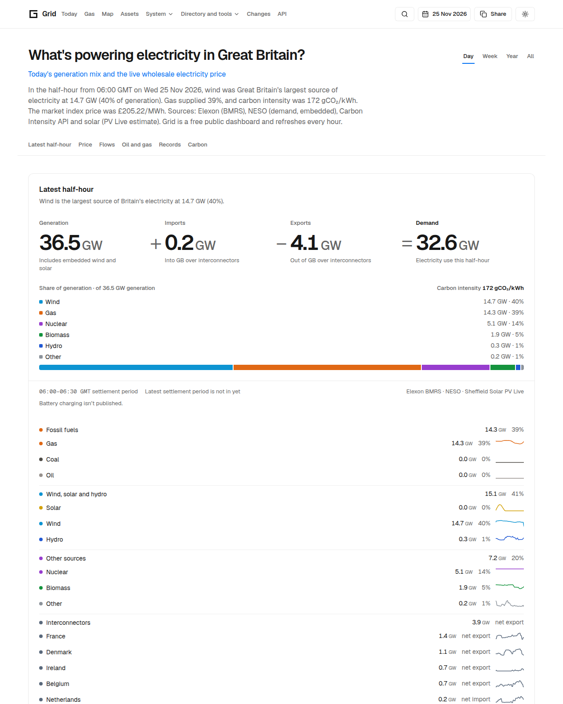
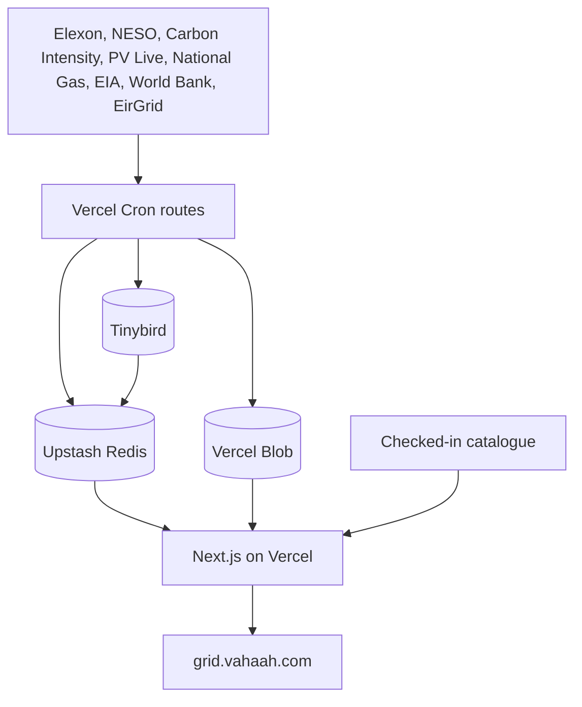

# Grid

Live dashboard of Great Britain's electricity and gas. Half-hourly settlement data, updated through the day, with the registers and prices around it.

**Live:** [grid.vahaah.com](https://grid.vahaah.com)
**Publisher:** Comonad Ltd · [alex@comonad.co.uk](mailto:alex@comonad.co.uk)



## Pages

| Page | What it shows |
| --- | --- |
| [/](https://grid.vahaah.com/) | Latest half-hour: generation, demand, carbon intensity, market price |
| [/today](https://grid.vahaah.com/today) | Today's mix, with a short answer and a map card |
| [/gas](https://grid.vahaah.com/gas) | National Transmission System supply, demand, linepack and storage |
| [/prices/gas](https://grid.vahaah.com/prices/gas) | GB System Average Price, Henry Hub, World Bank Europe gas and Japan LNG |
| [/map](https://grid.vahaah.com/map) | Interconnector and gas entry flows, power stations, DNO areas |
| [/assets](https://grid.vahaah.com/assets) | Operating stations from REPD and DUKES |
| [/projects](https://grid.vahaah.com/projects) | Planning, construction and connection status |
| [/pipeline](https://grid.vahaah.com/pipeline) | Renewable and storage projects by stage |
| [/system/storage](https://grid.vahaah.com/system/storage) | Pumped storage and batteries |
| [/system/constraints](https://grid.vahaah.com/system/constraints) | Transmission constraint cost and volume |
| [/system/balancing](https://grid.vahaah.com/system/balancing) | Balancing costs and BSUoS |
| [/system/whole-energy](https://grid.vahaah.com/system/whole-energy) | UK annual energy balance (DUKES), not today's figures |
| [/power-cuts](https://grid.vahaah.com/power-cuts) | Reported cuts in parts of England and Wales |
| [/electricity/northern-ireland](https://grid.vahaah.com/electricity/northern-ireland) | Northern Ireland and all-island electricity, kept out of GB totals |
| [/records](https://grid.vahaah.com/records) | Records since Grid's series began |
| [/explained/price-cap](https://grid.vahaah.com/explained/price-cap) | Ofgem price cap, as published |
| [/changes](https://grid.vahaah.com/changes) | Changes found in published registers |
| [/directory](https://grid.vahaah.com/directory) | MPID and industry-code lookup |
| [/tools](https://grid.vahaah.com/tools) | Official services, grouped by task |
| [/data-sources](https://grid.vahaah.com/data-sources) | Every source, with its licence and attribution |
| [/data-health](https://grid.vahaah.com/data-health) | When each series was published and when Grid fetched it |
| [/methodology](https://grid.vahaah.com/methodology) | Cadence, definitions, and how records are chosen |
| [/api](https://grid.vahaah.com/api) | JSON API and WebMCP tools |

## Data sources

Attributions on the site are the sentences below. Do not paraphrase them in the product.

| Source | Used for | Licence | Attribution |
| --- | --- | --- | --- |
| [Elexon BMRS](https://www.elexon.co.uk/bsc/data/balancing-mechanism-reporting-agent/copyright-licence-bmrs-data/) | Demand, FUELINST, Market Index, imbalance price, interconnectors | BMRS copyright licence | Contains BMRS data © Elexon Limited copyright and database right {year}. |
| Elexon ISD | MPID and role lookup | The ISD page does not identify the extract as BSC Open Data. Lookup only. Export is refused. | Industry Standing Data from the Elexon ISD Data Store. The store is publicly available. Grid shows the fields needed to look up a code. Elexon has not identified ISD under the BSC Open Data Licence, so Grid does not offer a download of the extract. |
| [NESO Open Data](https://www.neso.energy/data-portal/neso-open-licence) | Embedded wind, historic mix, constraints, TEC register, DNO areas | NESO Open Data Licence | Supported by National Energy SO Open Data |
| [Carbon Intensity API](https://carbonintensity.org.uk/) | National carbon intensity | CC BY 4.0 | National carbon intensity from the NESO Carbon Intensity API (CC BY 4.0). Developed by NESO with the University of Oxford, Environmental Defense Fund Europe and WWF. |
| [Sheffield Solar PV Live](https://www.solar.sheffield.ac.uk/pvlive/) | GB solar, including embedded | Open access | GB solar estimates from Sheffield Solar PV_Live, University of Sheffield, developed with NESO. |
| [EIA](https://www.eia.gov/) | Brent, WTI, Henry Hub | US government work | Source: U.S. Energy Information Administration. |
| [World Bank Pink Sheet](https://www.worldbank.org/en/research/commodity-markets) | Europe gas, Japan LNG | CC BY 4.0 | Source: World Bank Commodity Price Data (The Pink Sheet), CC BY 4.0. |
| [National Gas Data Portal](https://data.nationalgas.com) | System Average Price and NTS physical flows | Written consent, 14 Oct 2026 | Data sourced from the National Gas Transmission Data Portal. |
| DESNZ REPD and DUKES | Stations, projects, whole-energy balance | [Open Government Licence v3.0](https://www.nationalarchives.gov.uk/doc/open-government-licence/version/3/) | Contains public sector information licensed under the Open Government Licence v3.0. |
| [EirGrid Smart Grid Dashboard](https://www.smartgriddashboard.com/all/open-data-license/) | Northern Ireland and all-island series | EirGrid Group Open Data Licence | Supported by EirGrid Group Data |
| [GeoNames](https://www.geonames.org/) | Approximate landing points and terminal pins | CC BY 4.0 | Place coordinates from GeoNames, CC BY 4.0. |
| ONS National Statistics Postcode Lookup (August 2026) | Postcode to local authority. BT postcodes are excluded. | OGL and the OS / Royal Mail notices | Contains OS data © Crown copyright and database right 2026. Contains Royal Mail data © Royal Mail copyright and database right 2026. Source: Office for National Statistics licensed under the Open Government Licence v.3.0 |
| OS Open Zoomstack | Basemap on `/map` | OGL v3.0 | Ordnance Survey credit is on the map. |

The raw forecast series from the Carbon Intensity API is not republished. Grid shows a derived cleanest-window answer.

## Architecture

Next.js on Vercel. Time series for the GB electricity dashboard and commodity prices sit in Tinybird (ClickHouse). Upstash Redis holds the slot lock, the daily Tinybird counter, workflow step bodies, and warmed envelopes. Vercel Blob holds gas releases, constraints, Northern Ireland, the directory snapshot, map flows, and the postcode shards. Plant registers, projects, and the whole-energy edition are JSON and NDJSON in `data/catalogue/`. There is no database.

`/` is `force-static` with `revalidate` 300. It does not load MapLibre. A successful ingest calls `revalidatePath("/")`.



Electricity ingest runs every 30 minutes (`/api/cron`). Physical gas is hourly. Oil and gas prices run every 6 hours. The schedules are in `vercel.json`.

## Public API

No API key. The limit is 60 requests a minute per IP, per instance, in `src/proxy.ts`. `/api/health` and the cron routes are excluded.

The human page is [/api](https://grid.vahaah.com/api). Older routes still answer:

- `GET /api/dashboard`
- `GET /api/snapshots`
- `GET /api/generation`
- `GET /api/interconnectors`
- `GET /api/prices`
- `GET /api/look-ahead`
- `GET /api/health`

Newer routes are under `/api/v1/` (gas, constraints, projects, changes, identifiers, map layers, balancing, data health, Northern Ireland). `POST /api/v1/postcode` takes the postcode in the body. It is not logged. `GET` and `POST /api/v1/identifiers/export` return 403.

[/llms.txt](https://grid.vahaah.com/llms.txt) is a short index for agents.

In a browser that provides `document.modelContext`, Grid registers read-only WebMCP tools: `get_live_mix`, `get_carbon_intensity`, `get_wholesale_price`, `get_price_cap`, `search_grid`, `get_page_dataset`, `get_balancing_summary`, `get_data_health`. They read the page or the existing public JSON. They do not look up an MPAN, MPRN, or meter.

## Local development

```bash
git clone https://github.com/vahaah/energy-dashboard.git
cd energy-dashboard
npm install
cp .env.example .env.local
npm run dev
```

Node.js 22.12 or newer. `package.json` sets `"private": true` so the package is not published to npm. That flag is independent of the GitHub repository's visibility.

| Name | Purpose |
| --- | --- |
| `TINYBIRD_URL` | Tinybird API host |
| `TINYBIRD_TOKEN` | Workspace admin token, used by cron ingest |
| `TINYBIRD_READ_TOKEN` | `dashboard_read` token for pipe queries |
| `EIA_API_KEY` | EIA open data, required for price ingest |
| `CRON_SECRET` | Bearer token for cron routes. Required. They fail closed without it. |
| `UPSTASH_REDIS_REST_URL` | Optional Upstash REST URL (`https://` only) |
| `UPSTASH_REDIS_REST_TOKEN` | Paired with the REST URL |
| `KV_REST_API_URL` | Marketplace Redis alias for the REST URL |
| `KV_REST_API_TOKEN` | Marketplace Redis alias for the REST token |
| `BLOB_READ_WRITE_TOKEN` | Vercel Blob for basemap upload and published releases |
| `DIRECTORY_BLOB_STORE_ID` | Private Blob store id for the ISD snapshot |
| `DIRECTORY_BLOB_READ_WRITE_TOKEN` | Token for that private store |
| `INDEXNOW_KEY` | Must match the public key file. Submit scripts only. |
| `BASEMAP_MBTILES` | Optional local MBTiles path for a basemap rebuild |
| `OIL_PRICE_API_KEY` | Unused. Ingest is disabled. |
| `FRED_API_KEY` | Unused. Ingest is disabled. |

Tinybird setup is in [`tinybird/README.md`](./tinybird/README.md).

```bash
pip install tinybird-cli
tb login
cd tinybird && tb --cloud deploy
tb --cloud token ls
```

Seed a local snapshot with `CRON_SECRET` set:

```bash
curl -H "Authorization: Bearer $CRON_SECRET" http://localhost:3000/api/cron
```

## Scripts

| Command | What it does |
| --- | --- |
| `npm run dev` / `npm run build` | Next.js. `predev` and `prebuild` rebuild search indexes and the homepage map card. They do not fetch. |
| `npm test` | Vitest |
| `npm run test:layout` | Playwright layout tests |
| `npm run publish-check` | Catalogue schema, referential integrity, and immutable release lines |
| `npm run indexnow` | Submit sitemap URLs whose `lastmod` is newer than the checkpoint |
| `npm run indexnow:once` | One-shot after a release marker is live in production |
| `npx tsx scripts/backfill.ts --days 30` | Historical grid and EIA backfill. `--from` / `--to` are UK settlement dates. |
| `npx tsx scripts/backfill-commodities.ts --dry-run` | Commodity desk healer |
| `npx tsx scripts/backfill-gb-gas-sap.ts` | GB gas SAP backfill. Dry-run unless you pass `--execute`. |
| `npm run catalogue:assets` | Rebuild the plant register from a local REPD / DUKES cache |
| `npm run catalogue:projects` | Rebuild projects from local REPD and TEC files |
| `npm run basemap` | Manual Zoomstack PMTiles upload. Exits immediately when `BLOB_READ_WRITE_TOKEN` is unset. |

Catalogue commands that say `--offline` read `data/catalogue/raw/` and fail if that cache is missing. They do not fall through to HTTP. The raw extracts are gitignored.

## Testing

```bash
npm run lint
npm run typecheck
npm run publish-check
npm test
npm run test:layout
```

Playwright uses Chromium. Layout coverage is 1280, 1024, 768 and 375, light and dark. CI runs the unit job once and the layout job in four shards. The map specs run as their own project, one worker.

## Deployment

Vercel deploys `main`. Set the environment variables above in the project. Cron routes are in `vercel.json`.

After a production deploy, `.github/workflows/indexnow-submit.yml` submits changed sitemap URLs. The IndexNow key in `public/` is public on purpose. Workflows do not print it. The one-shot workflow redacts `INDEXNOW_KEY` in its logs.

## Contributing

See [CONTRIBUTING.md](./CONTRIBUTING.md). Security reports go to [alex@comonad.co.uk](mailto:alex@comonad.co.uk). See [SECURITY.md](./SECURITY.md).

## Licence

The code is MIT. See [LICENSE](./LICENSE). Grid's derived data is CC BY 4.0, with credit to Grid. Upstream data stays under each source's own licence and attribution, listed above and on [/data-sources](https://grid.vahaah.com/data-sources). [/llms.txt](https://grid.vahaah.com/llms.txt) uses the same three terms.

Vendored agent skills under `.agents/skills/` keep their own licence files. `skills-lock.json` records the upstream commit for each one.
